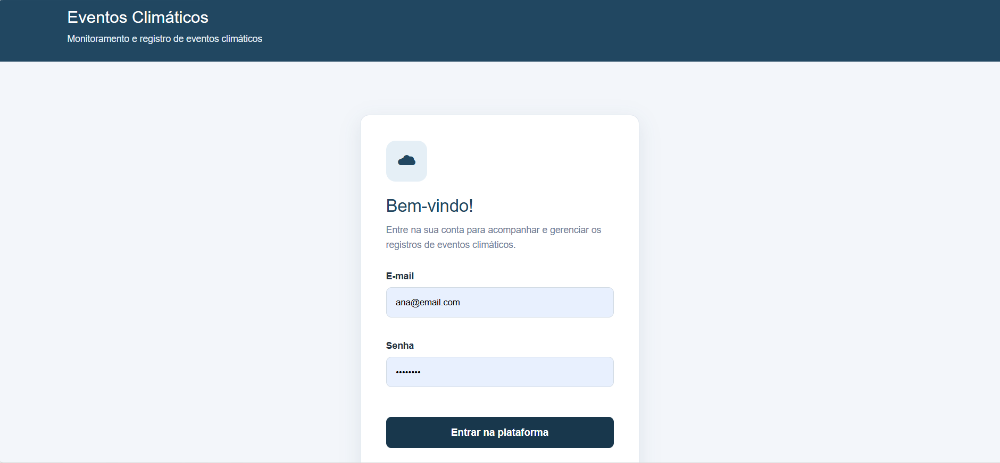
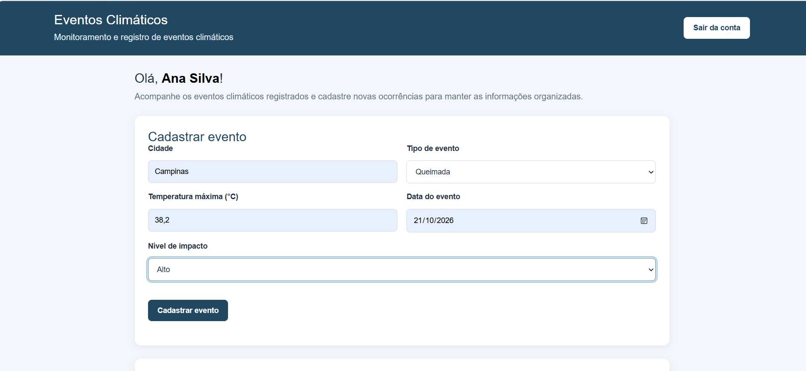
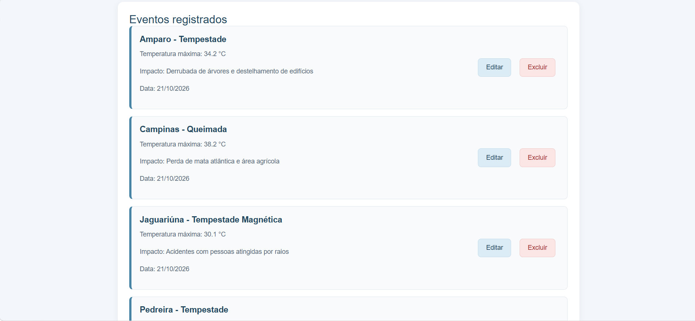

# Eventos Climáticos

## Sobre o projeto

O projeto Eventos Climáticos foi desenvolvido com o objetivo de cadastrar, consultar e gerenciar eventos climáticos, permitindo visualizar informações como cidade, tipo de evento, temperatura máxima, data e possíveis impactos.

O sistema possui uma interface web integrada a uma API, que realiza a comunicação com o banco de dados para armazenar e gerenciar as informações.

## Funcionalidades

- Login de usuários.
- Exibição do nome do usuário conectado.
- Cadastro de eventos climáticos.
- Listagem dos eventos cadastrados.
- Consulta das informações de cada evento.
- Edição de eventos existentes.
- Exclusão de eventos.
- Sugestão automática de descrição do impacto conforme o tipo de evento selecionado.
- Armazenamento dos dados em banco de dados MySQL.

## Tecnologias utilizadas

### Front-end
- HTML5
- CSS3
- JavaScript

### Back-end
- Node.js
- Express
- Prisma ORM

### Banco de dados
- MySQL

### Ferramentas
- Visual Studio Code
- Git
- GitHub
- Postman

## Telas do sistema

### 1. Home

Tela inicial do sistema, com identificação do usuário conectado e acesso às funcionalidades de cadastro e consulta dos eventos climáticos.



### 2. Tabela

Tela destinada à visualização das informações dos eventos climáticos organizadas em tabela.



### 3. Registros existentes

Tela que apresenta os eventos climáticos cadastrados, incluindo cidade, tipo de evento, temperatura máxima, descrição do impacto e data, com opções para editar ou excluir registros.



## Estrutura do projeto

```text
eventos/
├── api/
│   ├── src/
│   │   ├── controllers/
│   │   ├── routes/
│   │   └── data/
│   ├── prisma/
│   ├── package.json
│   └── server.js
│
├── web/
│   ├── css/
│   │   └── style.css
│   ├── js/
│   │   ├── login.js
│   │   └── home.js
│   ├── index.html
│   └── home.html
│
├── screenshots/
│   ├── home.png
│   ├── tabela.png
│   └── registros.png
│
└── README.md
```

## Como executar o projeto

### 1. Pré-requisitos

Instale ou configure as seguintes ferramentas:

- Node.js
- MySQL
- Visual Studio Code
- Git

### 2. Configurar a API

Abra o terminal na pasta `api`:

```bash
cd api
npm install
```

Configure as variáveis de ambiente e a conexão com o banco de dados MySQL conforme a configuração do projeto.

Execute as migrações do Prisma, caso necessário, e gere o cliente Prisma conforme a versão utilizada.

### 3. Iniciar o servidor

Na pasta `api`, execute o comando configurado no projeto para iniciar o servidor. Se o arquivo principal for `server.js`, você pode usar:

```bash
node server.js
```

A API ficará disponível, por padrão, em:

```text
http://localhost:3000
```

### 4. Abrir o front-end

Abra o arquivo `web/index.html` utilizando o Live Server do Visual Studio Code.

Com a API em execução, acesse a página de login e entre com um usuário cadastrado no banco de dados.

## Rotas principais da API

| Método | Rota | Descrição |
|---|---|---|
| POST | `/usuario/login` | Realiza o login |
| POST | `/usuario` | Cadastra um usuário |
| GET | `/usuario` | Lista os usuários |
| GET | `/usuario/:id` | Consulta um usuário |
| PUT | `/usuario/:id` | Atualiza um usuário |
| DELETE | `/usuario/:id` | Exclui um usuário |
| POST | `/evento` | Cadastra um evento |
| GET | `/evento` | Lista os eventos |
| PUT | `/evento/:id` | Atualiza um evento |
| DELETE | `/evento/:id` | Exclui um evento |

## Banco de dados

O sistema utiliza o MySQL para armazenar os usuários e os eventos climáticos.

Cada evento possui informações como:

- Cidade.
- Tipo de evento climático.
- Temperatura máxima.
- Data do evento.
- Descrição do impacto.
- Identificação do usuário relacionado ao cadastro.

O Prisma ORM é utilizado para facilitar a comunicação entre a aplicação e o banco de dados.

## Objetivo educacional

Este projeto foi desenvolvido como atividade prática de desenvolvimento de sistemas, aplicando conhecimentos de desenvolvimento web, integração entre front-end e back-end, operações CRUD, APIs REST e banco de dados relacional.

---

Desenvolvido como projeto educacional do SENAI pela aluna Letícia Corrêa.
